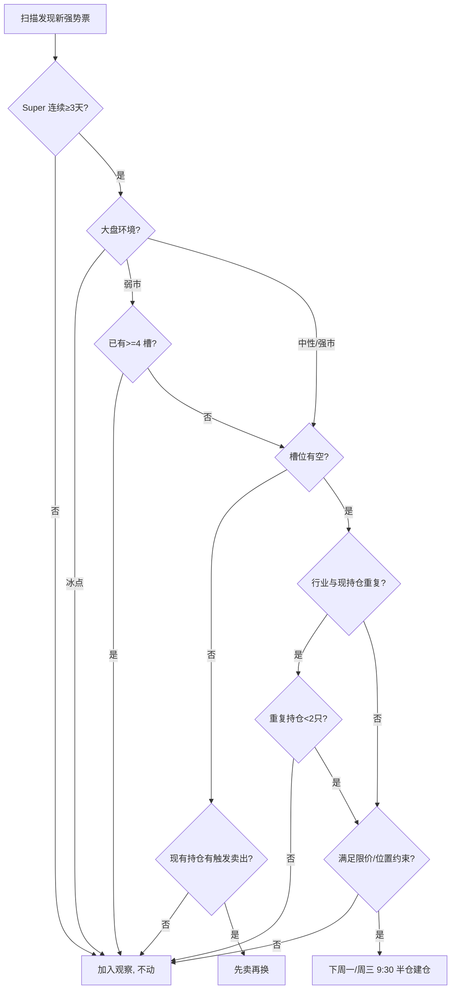

# A 股 RPS / TDX 系统 — 实战策略与每日 SOP

> 版本 v1.0  |  与 [strategy_early_launch.md](./strategy_early_launch.md) 互补
>
> 本文是**操作手册**，不是验证报告。所有阈值都基于已验证的几个月窗口给出
> 默认值，长期跑后再回测调整。

---

## 0. 策略一句话定位

**用 L1/L2 找强势池，用 Super 持续性筛核心标的，用周节奏调仓，用纪律卖出。**

不做：日内追涨杀跌、消息驱动追板、ST/微盘股、未盈利新股。

---

## 1. 仓位框架

### 1.1 槽位制（固定 8 个槽，不超）

| 槽 | 数量 | 来源 | 单票仓位 | 持有周期 |
|---|---:|---|---:|---|
| **核心槽** | 5 | Super 持续性 ≥ 45% + L1 ≥ 60% + 3 层覆盖 | 8-10% | 月度级 |
| **机动槽** | 3 | Huoche FIRST_W 或 Early∩L1 (HOLD ≥ 3) | 5-7% | 周-双周级 |

**总持仓上限 = 8 只**。不允许"看到新强势票就挤掉老的"。槽位满了就**等老票自己触发卖出**，再补新票。

### 1.2 总仓位 = 槽位仓位之和 × 大盘环境系数

| 大盘环境 | 系数 | 实际总仓位 | 判定 |
|---|---:|---:|---|
| 强市 | 1.0 | 60-80% | 沪深300 收盘 > MA20，**且** 5 日中位涨家数 ≥ 2500 |
| 中性 | 0.7 | 40-60% | 沪深300 在 MA20 附近 (±2%) |
| 弱市 | 0.4 | 20-30% | 沪深300 < MA20，**或** 5 日中位涨家数 < 1500 |
| 冰点 | 0.0 | **空仓观察** | 涨停 < 10 连续 3 天，或 5 日中位涨家数 < 800 |

弱市时**先减再不加**，冰点时**清核心保机动现金**。

---

## 2. 选股标准

### 2.1 核心槽（5 个）— 来自月度持续性榜

输入：[`run_persistence_scan.py`](../run_persistence_scan.py) 上月窗口结果

筛选（**全部满足**）：

| 条件 | 阈值 | 来自字段 |
|---|---:|---|
| Super 持续性 | `super_rate ≥ 0.45` | persistence csv |
| L1 持续性 | `l1_rate ≥ 0.60` | 同上 |
| 层覆盖 | `layers_covered ≥ 3` | 同上 |
| 当日 close > MA20 | 必须 | 当日扫描 |
| close / MA60 - 1 | ≤ 50% | 当日扫描 |
| 20 日累涨 ret20 | ≤ 50% | 当日扫描 |
| 行业不与现持仓重复 | 必须 | 手动判 |

排序：**`super_rate` 降序**（不是 `score`，因为 score 会受 Huoche 权重影响把"已涨满型"排太前），前 5 入核心槽。

筛选脚本：`py -3 .\tools\rank_core_picks.py output\persistence_<start>_<end>.csv`

> **阈值历史**：v1 用 0.60/0.70，4 月强势月只能填 2 槽，证明太严；v2 改 0.45/0.60，4 月可填 5-6 槽。
> **不能买的反面例子**：score 高但 close/MA60 - 1 已 > 60% 的（已加速末段，例如 4 月底很多 CPO 票）。

### 2.2 机动槽（3 个）— 来自每日扫描

| 来源 | 触发条件 | 持有目标 |
|---|---|---|
| Huoche FIRST_W | 当日首次出现 + 当日 close > MA20 | 1-2 周 |
| Super NEW HOLD ≥ 3 | 连续 3 天在 Super 榜 | 1-2 周 |
| Early∩L1 NEW HOLD ≥ 3 | 连续 3 天在 Early∩L1 | 1-2 周 |

**机动槽是给"短期信号"用的**，不要拿核心槽的纪律套机动槽（机动槽的卖出规则更严：见 §3）。

---

## 3. 卖出规则（任一触发即卖）

按**优先级**从高到低执行：

### 3.1 硬性止损 — 不讨论

| 触发 | 阈值 | 动作 |
|---|---|---|
| 成本止损 | 浮亏 ≤ -8% | **全部清仓** |
| 闪崩 | 单日跌 ≥ -7% | **全部清仓**，下一交易日开盘前确认 |

### 3.2 趋势破坏 — 优先清仓

| 触发 | 阈值 | 动作 |
|---|---|---|
| 收盘 < MA60 | 1 次 | **全部清仓** |
| 连续 2 天收盘 < MA20 | 2 天 | 核心槽减半，机动槽全清 |
| 周线火车轨 W_SXHCG = False 持续 2 周 | — | 核心槽减半 |

### 3.3 持续性丢失 — 体面卖出

| 触发 | 阈值 | 动作 |
|---|---|---|
| 连续 5 天不在 Super 榜 | 仅核心槽 | 减半 |
| 连续 10 天不在 Super 榜 | 仅核心槽 | 全清 |
| 连续 3 天不在 L1 | 机动槽 | 全清 |

### 3.4 止盈 — 兑现纪律

| 触发 | 阈值 | 动作 |
|---|---|---|
| 浮盈 ≥ 25% | — | **减半仓** |
| 从最高价回撤 -15% | — | 剩余清仓 |
| 持仓 30 个交易日浮盈 < 5% | — | 全部清仓（时间止损） |

> **不要被「这票还在 Super 榜」绑架**。卖出由持仓自身规则决定，扫描只用于排队下一个买点。

---

## 4. 买入规则

### 4.1 何时下单

- **集中下单日**：周一 9:30-10:30。
- **额外允许日**：周三 9:30-10:30（仅当周一未填满槽位且新候选出现）。
- **不允许日**：其它时段。除非 Huoche FIRST_W 当日触发**且**大盘强市 → 当日 14:30-14:50 可建机动仓 50%。

### 4.2 怎么下单

| 场景 | 限价 | 备注 |
|---|---|---|
| 核心槽建仓 | 上一日收盘价 ± 1% | 不追，挂单不到不买 |
| 机动槽建仓 | 上一日收盘价 ± 2% | Huoche FIRST_W 可放宽到 +3% |
| 加仓（仅核心） | 浮盈 ≥ 10% 后回踩 MA10 加 1/3 | 单票最高仍不超 12% 仓 |

### 4.3 第一笔不买满

新进场建议**先建半仓**，3-5 个交易日观察后再决定补满。

---

## 5. 大盘环境判定（每日盘后）

四个观察项目，按重要性顺序：

1. **沪深300 收盘 vs MA20**：站上为基础多头。
2. **5 日中位涨家数**：广度指标，判定真假强势。
3. **涨停数 / 跌停数**：极端情绪。
4. **创业板/科创板指数 vs MA20**：成长板块同步性。

→ 综合判定 §1.2 表格的四档之一。

> 当前 [`run_tdx_screener.py`](../run_tdx_screener.py) 还没输出大盘行，等 P1 改进。
> 暂时手动看：通达信 880003（沪深300）+ 880005（涨家数）。

---

## 6. 每日操作清单

### 6.1 盘后 15:30 - 16:00（必做）

```bash
# 步骤 1: 确认通达信本地数据已下载到今天
# 步骤 2: 跑全套扫描
py -3 .\run_tdx_screener.py --date YYYYMMDD

# 步骤 3: 看输出关键部分
#   [L1] / [L2] / [Super] / [Huoche] / [Early∩L1] 跟踪
#   特别关注: Huoche [NEW] 列表（强信号）
#            Super [NEW] 列表（连续 3 天再考虑）

# 步骤 4: 把 Super 榜导成通达信板块（同步手机看）
py -3 .\csv_to_tdx_blk.py --csv output\tdx_screener_YYYYMMDD_super_codes.csv --name SUPER_YYYYMMDD

# 步骤 5: 持仓体检（先把 portfolio_template.csv 复制成 portfolio.csv 并填实际持仓）
py -3 .\run_portfolio_check.py --date YYYYMMDD
```

### 6.2 盘前 8:30 - 9:25（仅周一/周三）

| 动作 | 工具 |
|---|---|
| 1. 看昨日扫描和持仓体检报告 | 终端 / md |
| 2. 列今日卖出单（触发 §3 任一） | 手记 |
| 3. 列今日买入单（满足 §4） | 手记 |
| 4. 大盘环境判定，确认仓位上限 | 通达信指数 |
| 5. 9:25 集合竞价区间挂限价单 | 券商 APP |

### 6.3 盘中 9:30 - 15:00（默认不操作）

只看不动。允许的盘中动作：

| 情景 | 动作 |
|---|---|
| 持仓单日下跌触及 -8% | **强制清仓**，不等收盘 |
| 持仓单日下跌触及 -7% 且大盘强 | 准备清仓，最后 30 分钟决定 |
| Huoche FIRST_W 盘中已能确认（罕见） | 14:30 后建半仓 |

不允许：盯盘看波动；追今日涨停；情绪买卖。

### 6.4 周末（必做）

```bash
# 周持续性榜
py -3 .\run_persistence_scan.py --start 周一日期 --end 周五日期 --hold 0

# 决定下周调仓清单：
# - 卖：本周内已触发 §3 任一规则的持仓
# - 买：周持续性榜 Super≥80% 且未持有 + §4 限价规则

# 周日晚把下周操作写到记事本，周一开盘前不修改
```

### 6.5 月初（必做）

```bash
# 月度持续性回测（验证信号有效性）
py -3 .\run_persistence_scan.py --start 上月1日 --end 上月底 --hold 10

# 看回测分桶报告:
#   Super≥80% 组中位收益 vs Super<20% 组中位收益
#   预期: 至少 +5pp 中位超额, 否则降仓 / 调阈值
```

---

## 7. 决策树（每个新候选都按这个走）



---

## 8. 不该做的事（红线）

1. **不在槽位满时挤掉老票换新票**。等老票自己被规则卖出。
2. **不因为「今天这票还在 Super」就不卖**。卖出由持仓自身规则决定。
3. **不在弱市加仓**。即使榜单很漂亮，弱市真假信号比例失衡。
4. **不在涨停板挂买单追**。Huoche FIRST_W 也不能违反 +3% 限价。
5. **不重仓单一题材**。即使榜单 30 只里 20 只是 CPO，也要分散。
6. **不日内频繁 T+0 / 做 T**。本系统是日线-周线策略，做 T 不在该框架内。
7. **不动用持仓资金做新候选**。新候选用现金或机动槽空仓位。

---

## 9. 已知盲点

| 盲点 | 当前办法 |
|---|---|
| 没有自动行业映射 | 手动看通达信行业，避免 ≥2 只同板块 |
| 大盘环境靠人判 | 暂手工读沪深300/涨家数，等 P1 输出 |
| forward return 验证样本仅几个月 | 当前只能跑近 3-6 个月，长期需积累 |
| 未做交易成本回测 | 手动估算：单边 0.13% 印花+佣金，10 日持有约 0.26%，影响有限 |
| 突发利好/暴雷 | 盘中规则不覆盖，发生时立刻按 §3.1 处理 |

---

## 10. 文件清单

| 用途 | 文件 |
|---|---|
| 日内扫描入口 | [`run_tdx_screener.py`](../run_tdx_screener.py) |
| 月度持续性扫描 | [`run_persistence_scan.py`](../run_persistence_scan.py) |
| 持仓体检 | [`run_portfolio_check.py`](../run_portfolio_check.py) (配 [`portfolio_template.csv`](../portfolio_template.csv)) |
| 输出板块导通达信 | [`csv_to_tdx_blk.py`](../csv_to_tdx_blk.py) |
| 早期启涨策略 | [`strategy_early_launch.md`](./strategy_early_launch.md) |
| 洪战法 | [`strategy_hong_zhanfa.md`](./strategy_hong_zhanfa.md) |

---

## 11. 上线前检查

按这个清单逐项确认才开始按 SOP 跑：

- [ ] 通达信本地数据每日 15:10 后能稳定下到当日数据
- [ ] [`run_tdx_screener.py`](../run_tdx_screener.py) 当日跑通，输出 5 个池 + NEW/EXIT/HOLD
- [ ] 上月持续性榜跑过一次，看到 top-30 是否符合直觉
- [ ] 持仓体检工具就绪（P0）
- [ ] 券商 APP 限价单 / 止损单设置熟悉
- [ ] 用 5-10% 的资金试跑 2 周，再放大

---

> **最重要的一条**：纪律 > 选股能力。系统能给你榜单，给不了纪律。
